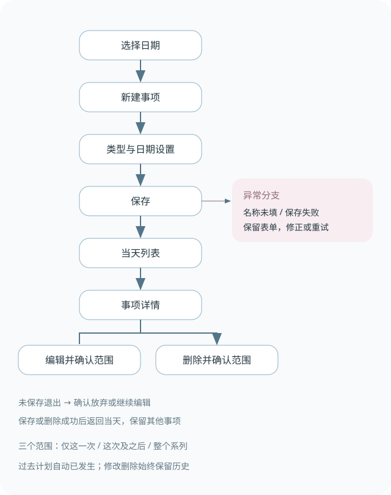

# 万事历 原型与流程
版本：V0.5 · 更新：2026-11-19

[产品前端](https://yushumeng532.github.io/wanshili/app.html) · [工作台](https://yushumeng532.github.io/wanshili/) · [Figma演示](https://www.figma.com/proto/8aE2Z9hUhKtxgXjnEuCY7I?node-id=3-4&page-id=2%3A2&starting-point-node-id=3%3A4&scaling=scale-down&content-scaling=fixed&show-proto-sidebar=1)

## 1. 本版流程

选日 → 新建 → 类型与日期 → 保存 → 当天列表 → 详情 → 编辑或删除。正计时只设开始日期；倒数日可以设置循环和持续次数。过去日程自动已发生，不再人工确认。

## 2. 画框对应

| 模块 | 页面 | Figma节点 |
| --- | --- | --- |
| 01 | 月历有记录、空态；当天多项、空态 | 3:3～3:6 |
| 02 | 空表单、正计时、倒数日、生日 | 3:8～3:11 |
| 02 | 循环、纪念日说明 | 3:12、3:13 |
| 02补充 | 日期、每周、每月、每年 | 137:3067、137:3182、137:3804、137:3911 |
| 02补充 | 循环持续次数 | 171:530 |
| 03补充 | 同事项跨标签页冲突 | 171:744 |
| 03 | 详情、编辑、修改范围、删除范围 | 3:15～3:18 |
| 03范围选中态 | 编辑：这次及之后、整个系列 | 170:2485、170:2594 |
| 03范围选中态 | 删除：这次及之后、整个系列 | 170:5373、170:5477 |

原画框保留ID，在原02、03模块中更新；修改前备份保留在流程与评审Page。补充名称校验、保存中、成功、失败、未保存退出和持续次数说明。范围选择包含三种选中态与确认跳转。

## 3. 查看与评审

工作台网页演示可填写表单并完成创建、详情、编辑与删除；数据仅在本次页面保留。标注模式通过原型锚点和文档章节相互定位。Figma保留可编辑图层、原型连线和已有动效；使用固定示例说明规则。

所有画框按390 × 844等比显示。正计时取消循环和次数；详情取消人工发生按钮；类型锁定、历史保留、月末回退、闰日跳过与AI未接入均有说明。运行时日期计算、保存、跨标签页保护与统计在独立产品前端中验证。
